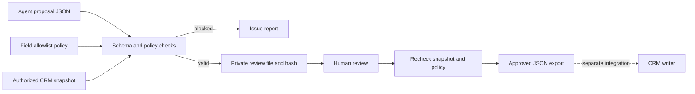

# CRM Change Approval Gate

**Review an AI assistant's proposed CRM updates before they become an import or API payload.**

This local utility checks a proposed batch against field allowlists, business constraints and an authorized record snapshot. A person reviews the old and proposed values and supplies the batch's approval hash. Only then can the tool export an approved payload.

**Status:** functional local prototype with 14 automated tests. No CRM connector is included, no model is called, and no real CRM records have been updated. This is a review component for an agentic workflow, not an autonomous agent or a production security boundary.

## Business problem

A meeting assistant or sales agent may suggest updating lead statuses or qualification scores. Well-formed JSON is insufficient: fields might be outside scope, a value might break a business rule, or the record might have changed since the proposal was generated. This tool separates proposal, validation, review and export.

## Open-source reuse and new work

This application reuses [python-jsonschema/jsonschema](https://github.com/python-jsonschema/jsonschema), pinned to **4.25.1**, under its MIT license. `Draft202012Validator` performs input and field-value validation. This is a dependency-based application, not a fork of the validator or a claim to have authored it.

The new application adds CRM object/field allowlists, expected-value comparison, batch limits, duplicate rejection, review fingerprints, snapshot-drift checks and a separate approved export. See [THIRD_PARTY.md](THIRD_PARTY.md) for provenance and the upstream notice.

## Workflow



No CRM calls occur. A separate integration must authenticate, recheck live CRM state immediately before a write, enforce permissions and handle idempotency.

## Install and test

Python 3.9+. Installation downloads packages from your configured registry.

```bash
python3 -m venv .venv
source .venv/bin/activate
python -m pip install -r requirements.txt
python -m unittest -v
```

`requirements.txt` pins the direct dependency. `requirements-tested.txt` records all versions used for the documented macOS/Python 3.9 test run; platforms can require different compatible builds.

## Run the example

`examples.json` contains nonconfidential fixtures, not customer records. Extract its sections into local input files:

```bash
python - <<'PY'
import json
from pathlib import Path
data = json.loads(Path('examples.json').read_text())
Path('private').mkdir(exist_ok=True)
for name, value in data.items():
    Path('private', name + '.json').write_text(json.dumps(value, indent=2))
PY

python gate.py plan \
  --proposal private/proposal.json \
  --policy private/policy.json \
  --snapshot private/snapshot.json \
  --out output/review-01
```

The valid example reports one proposed record change, zero errors, zero CRM writes and an approval hash. Inspect **both the old/new values and the policy** in `output/review-01/review.json` before approving:

```bash
python gate.py approve \
  --review output/review-01/review.json \
  --snapshot private/snapshot.json \
  --approve PASTE_THE_HASH_YOU_REVIEWED \
  --out output/approved-01
```

This creates `approved-changes.json` and `receipt.json`. Nothing is uploaded. Use a new output directory for each run; existing directories are never overwritten.

## Use your real workflow

Use authorized record exports or connector snapshots in the same format as the example. An LLM or coding agent can draft `proposal` JSON, but the person responsible for the process must approve the field allowlist and rules. The utility accepts real local files and never contacts an AI service.

Each update needs an `expected` old value for exactly the fields being changed. Policies support scalar types, enums, string lengths and numeric bounds. Unknown objects/fields, invalid shapes, duplicates, no-ops, missing records and stale values block the **entire batch**. Partial approval is unsupported.

Record IDs are opaque strings for compatibility across CRMs. The tool does not validate Salesforce IDs or fetch a live schema. Fields and values in the fixture are examples, not a promise about your Salesforce org.

## Outputs and privacy

| File | Contents | Sharing guidance |
| --- | --- | --- |
| `report.json` | Counts, error codes, paths and field names; no record values | Schema names may still be confidential |
| `review.json` | Proposal, expected/new values and policy | Private business data |
| `approved-changes.json` | Record IDs and approved values | Private business data |
| `receipt.json` | Approval/payload hashes, count, zero-write status | Review before sharing |

`private/`, `output/`, virtual environments and credentials are ignored by Git. Output directories use mode 0700 but are not encrypted. Source files remain unchanged.

## Validation and limitations

14 tests cover valid export, object/field denial, types/enums, expected values, stale data, duplicates/batch limits, missing records/no-ops, forbidden schema references, snapshot drift, tampering, no-overwrite behavior, report privacy, strict JSON parsing and deterministic policy-bound hashes. An end-to-end CLI check also exercises a valid plan/export and a blocked proposal.

- Inputs are limited to 2 MB each. Nested CRM field values and arbitrary user schemas are unsupported. Remote schema references are rejected.
- Fingerprints bind the proposal, policy and complete supplied snapshot. Even unrelated snapshot edits or reordering require review again. JSON representations are compared strictly.
- A hash is not a signature or proof of human identity. A model or malicious local user can calculate it. Independent identity, role enforcement and immutable auditing require an external service.
- A supplied snapshot cannot prove the live CRM is unchanged. The eventual writer must check concurrency. This exporter implements no live writes, rollback, retries or global replay prevention. Consumers must use `request_id` appropriately for idempotency.
- Local tests do not establish production readiness, business savings, AI accuracy or live CRM compatibility.

Exit codes: **0** plan/export succeeded; **1** policy blocked the batch and a report was saved; **2** processing error. CLI errors avoid echoing input record values.

## Contribution and AI assistance

Itziar Fernández Fernández supplied the portfolio direction: useful enterprise AI/automation tools with transparent open-source reuse. Codex selected and integrated the validator and generated the initial application, documentation and tests. Itziar's own review, live integration and later changes should be recorded as completed, not assumed. No employer repository or client material was used.

## Interview walkthrough

Run the example, add a disallowed field, show that no approved file is produced, then change the snapshot and show that the previous review is invalid. Explain schema validation versus business policy, approval versus live authorization, and the upstream library versus new application logic. Review the code and run these cases yourself before presenting them as hands-on experience.
